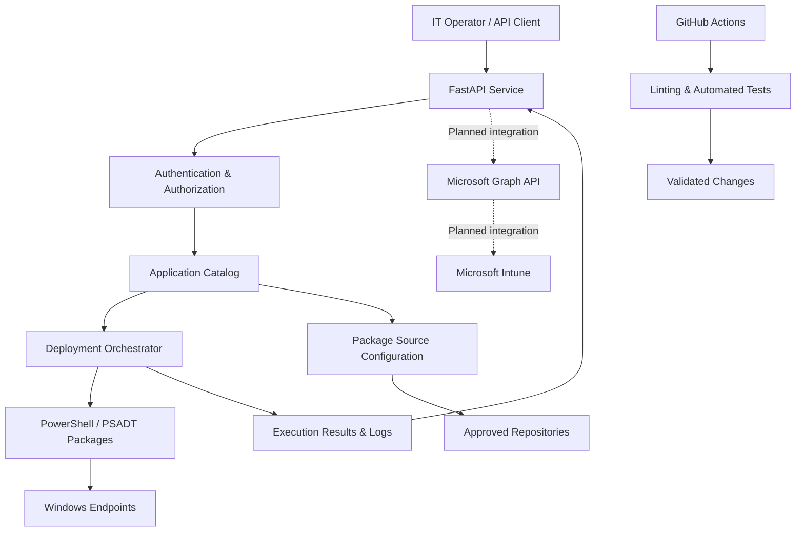

# Enterprise Deployment Automation Framework

**A modular IT automation project for standardized Windows application deployment, endpoint remediation, and API-driven operations.**

[](https://learn.microsoft.com/en-us/powershell/)
[](https://www.python.org/)
[](https://fastapi.tiangolo.com/)
[](https://www.microsoft.com/windows)
[](https://github.com/features/actions)

## Overview

Enterprise Deployment Automation Framework is a portfolio project exploring how software engineering principles can improve enterprise IT operations.

The project aims to centralize reusable application deployment packages, automate common endpoint maintenance tasks, and expose deployment catalog capabilities through a REST API.

It follows a modular architecture that separates application packaging, endpoint automation, API services, configuration, and continuous integration.

The framework is designed around realistic enterprise scenarios involving Windows endpoints and software management ecosystems such as Microsoft Intune and Microsoft Configuration Manager (SCCM).

**Project focus:** IT Automation, Systems Engineering, Platform Engineering, and DevOps.

> **Project status:** Development / Proof of Concept. Features and integrations are implemented incrementally. Microsoft Intune, Configuration Manager, and Microsoft Graph API connectivity must be considered planned until their respective integrations have been implemented and tested.

## Engineering Objectives

- Standardize application installation, upgrade, uninstallation, and detection workflows.
- Reduce repetitive manual intervention in endpoint maintenance.
- Build reusable PowerShell automation with structured logging and error handling.
- Design a configuration-driven application catalog that separates metadata from installation binaries.
- Develop a REST API for application catalog management and controlled automation requests.
- Explore secure integration with Microsoft Graph API using OAuth 2.0 client credentials.
- Introduce automated testing, static analysis, and CI workflows.
- Establish a foundation for future self-service IT operations.

## Architecture



The architecture separates the control plane from endpoint execution.

- **API layer:** Receives authorized requests and validates inputs.
- **Catalog layer:** Stores application metadata and source configuration.
- **Automation layer:** Coordinates deployment and remediation workflows.
- **Endpoint layer:** Executes approved PowerShell scripts and application packages.
- **Integration layer:** Provides a future extension point for Microsoft Graph and endpoint management platforms.
- **CI layer:** Validates code quality and tests before changes are merged.

The diagram describes the intended architecture; it does not imply that every component or integration is already operational.

## Technology Stack

| Technology | Purpose |
|---|---|
| PowerShell | Windows administration, deployment, and remediation |
| PSAppDeployToolkit (PSADT) | Standardized application deployment workflows |
| Python | API services and orchestration logic |
| FastAPI | REST endpoints, request validation, and API documentation |
| Microsoft Graph API | Planned integration with Microsoft cloud management services |
| OAuth 2.0 | Authentication for authorized service-to-service requests |
| JSON | Application metadata and source configuration |
| GitHub Actions | Continuous integration and automated validation |
| Pester | PowerShell testing |
| pytest | Python testing |
| PSScriptAnalyzer | PowerShell static analysis |

## Core Components

### 1. Application Packaging

Reusable deployment packages provide a consistent structure for supported Windows applications.

Each package should define:

- Application metadata and supported versions.
- Installation and uninstallation procedures.
- Silent installation parameters.
- Prerequisite and installation checks.
- Detection rules and exit codes.
- Structured logs and failure handling.
- Upgrade and repair behavior where supported.

Example catalog categories:

- Browsers: Google Chrome.
- Productivity: Microsoft Office.
- Messaging: WhatsApp.
- Templates: reusable PSAppDeployToolkit deployment structures.

PSADT is used as an existing deployment framework rather than presented as a custom implementation.

### 2. Configuration-Driven Package Sources

The package source configuration separates application metadata from the binaries themselves.

Example configuration:

```json
{
  "schema_version": "1.0",
  "applications": [
    {
      "id": "google-chrome",
      "name": "Google Chrome",
      "version": "stable",
      "source": {
        "type": "winget",
        "package_id": "Google.Chrome"
      },
      "deployment": {
        "type": "psadt",
        "script": "packages/browsers/Google-Chrome/Deploy-Application.ps1"
      }
    }
  ]
}
```

This example illustrates the proposed schema. The catalog implementation must validate package identifiers, source types, paths, and supported deployment methods before executing any operation.

**Design principles:**

- Avoid committing large installers to Git.
- Support approved local or remote package repositories.
- Validate package metadata before execution.
- Make package source selection explicit and auditable.
- Treat external downloads as untrusted until their provenance and integrity have been verified.

### 3. Endpoint Remediation

PowerShell utilities target common Windows endpoint maintenance scenarios.

Potential use cases include:

- Diagnosing Configuration Manager client cache issues.
- Checking the health and status of endpoint management services.
- Detecting problems with the Intune Management Extension.
- Collecting diagnostic information.
- Restarting services when appropriate.
- Producing structured execution results for troubleshooting.

Remediation scripts should separate detection from corrective actions wherever possible.

Destructive operations must be guarded by precondition checks, logging, and explicit error handling. Cache cleanup should use supported management mechanisms where available instead of indiscriminately deleting cache contents.

These scripts are intended for controlled testing in disposable virtual machines or other authorized lab environments, not for unvalidated deployment to production endpoints.

### 4. REST API

The FastAPI service is intended to expose a controlled interface for catalog operations and automation requests.

Proposed capabilities:

| Endpoint | Purpose |
|---|---|
| `GET /health` | Check API availability |
| `GET /api/v1/packages` | List available packages |
| `GET /api/v1/packages/{package_id}` | Retrieve package metadata |
| `POST /api/v1/deployments` | Submit a deployment request |
| `GET /api/v1/deployments/{deployment_id}` | Retrieve execution status |

These endpoints represent the proposed API contract and should be treated as planned until implemented.

A deployment request should not automatically execute an arbitrary script or shell command. The service should accept only validated package identifiers and approved parameters, enforce authorization, and execute work through a controlled orchestration mechanism.

Long-running deployment jobs should eventually use a background worker and a persistent job-status store rather than blocking an HTTP request.

### 5. Microsoft Graph Integration

The planned Graph integration provides an extension point for interacting with supported Microsoft cloud management resources.

The implementation will explore:

- OAuth 2.0 client credentials.
- Microsoft Entra application registration.
- Least-privilege application permissions.
- Token acquisition and expiration handling.
- Graph API error handling and throttling.
- Audit logs for management operations.

Credentials must be supplied through environment variables or a secrets manager and must never be committed to source control.

Actual API capabilities depend on the relevant Microsoft Graph endpoints, permissions, licensing, and management platform constraints.

### 6. CI and Code Quality

GitHub Actions will validate the project whenever changes are pushed or submitted through a pull request.

Planned checks include:

- PowerShell static analysis with PSScriptAnalyzer.
- PowerShell unit tests with Pester.
- Python linting and automated tests.
- API schema and request-validation tests.
- Configuration schema validation.
- Dependency and secret scanning.

CI validates code and configuration; it does not prove that a package installs successfully on every supported endpoint. Integration testing in a Windows lab remains necessary.

## Repository Structure

```text
enterprise-deployment-automation/
├── .github/
│   └── workflows/
│       ├── powershell-ci.yml
│       └── python-ci.yml
├── docs/
│   ├── architecture.md
│   ├── security.md
│   ├── api-reference.md
│   └── troubleshooting.md
├── portal-backend/
│   ├── app/
│   │   ├── main.py
│   │   ├── api/
│   │   ├── services/
│   │   ├── repositories/
│   │   └── schemas/
│   ├── tests/
│   └── requirements.txt
├── scripts/
│   ├── diagnostics/
│   ├── remediation/
│   └── shared/
├── packages/
│   ├── catalog.json
│   ├── templates/
│   ├── browsers/
│   ├── productivity/
│   └── messaging/
├── tests/
│   └── powershell/
├── .gitignore
├── LICENSE
└── README.md
```

This structure is the intended repository layout. Directories and files should be added as the corresponding components are implemented.

## Getting Started

### Prerequisites

- Windows 10/11 or a supported Windows lab environment for endpoint scripts.
- PowerShell 5.1 or a compatible PowerShell 7 release, depending on the script.
- Python 3.11 or a compatible version specified by the project.
- Git.
- Optional: PSAppDeployToolkit, a test application installer, and a Windows virtual machine.

### 1. Clone the repository

```bash
git clone https://github.com/YOUR_USERNAME/enterprise-deployment-automation.git
cd enterprise-deployment-automation
```

### 2. Set up the API

Run the following commands from the repository root:

```bash
cd portal-backend

python -m venv .venv
```

Activate the environment on Windows PowerShell:

```powershell
.\.venv\Scripts\Activate.ps1
```

Install dependencies and start the development server:

```bash
python -m pip install -r requirements.txt
uvicorn app.main:app --reload
```

The commands assume the API entry point is implemented at `portal-backend/app/main.py` and exports a FastAPI instance named `app`.

If the project uses a different entry point, adjust the command to match the actual implementation.

When the server is running, FastAPI's interactive API documentation is normally available at:

- `http://127.0.0.1:8000/docs`
- `http://127.0.0.1:8000/redoc`

### 3. Validate PowerShell scripts

Install the required development modules in your test environment:

```powershell
Install-Module PSScriptAnalyzer -Scope CurrentUser
Install-Module Pester -Scope CurrentUser
```

Run static analysis:

```powershell
Invoke-ScriptAnalyzer -Path .\scripts -Recurse
```

Run automated tests after the test suite has been created:

```powershell
Invoke-Pester .\tests\powershell
```

### 4. Test endpoint scripts safely

Use a Windows virtual machine with a snapshot and no production management dependencies.

Before running a remediation script:

1. Read the script and verify its target paths and service names.
2. Confirm that its preconditions match the lab environment.
3. Run static analysis and tests.
4. Execute it with the minimum required privileges.
5. Review logs and verify the expected postconditions.

Do not use a blanket `Unrestricted` execution policy as a substitute for script validation or security controls.

## Security and Reliability

The framework follows several engineering principles:

- **Least privilege:** Restrict API access and use only the permissions required for each operation.
- **Input validation:** Validate package IDs, parameters, paths, and source metadata.
- **Secrets management:** Never store client secrets, access tokens, or credentials in Git.
- **Safe execution:** Allowlist approved deployment actions rather than executing arbitrary user-provided commands.
- **Observability:** Capture timestamps, operation IDs, execution outcomes, and actionable error details.
- **Idempotency:** Avoid unnecessary changes when the target application or configuration is already in the desired state.
- **Failure isolation:** Separate API failures from endpoint execution failures.
- **Auditability:** Record who requested an operation, what was requested, and the resulting status.
- **Controlled recovery:** Use explicit preconditions and recovery procedures for potentially disruptive operations.

Production use would require additional security reviews, permission configuration, deployment testing, and operational safeguards.

## Testing Strategy

The project will use a layered testing strategy.

| Layer | Validation |
|---|---|
| Static analysis | PowerShell and Python code quality |
| Unit tests | Catalog parsing, validation, and service logic |
| API tests | HTTP status codes, schemas, and authorization |
| Package tests | Installation, detection, upgrade, and uninstall |
| Integration tests | API-to-orchestrator and Graph connectivity |
| Recovery tests | Remediation behavior and failure handling |
| CI validation | Automated checks on every proposed change |

Success criteria should be measurable: for example, passing test suites, correct detection results, expected exit codes, and successful recovery from documented failure scenarios.

## Roadmap

- [ ] Establish repository structure and development conventions.
- [ ] Implement and test the application catalog schema.
- [ ] Create a reusable PSAppDeployToolkit package template.
- [ ] Develop one fully tested Windows application package.
- [ ] Implement safe diagnostic and remediation scripts.
- [ ] Build the initial FastAPI endpoints and request validation.
- [ ] Add structured logging and deployment status tracking.
- [ ] Configure GitHub Actions for Python and PowerShell validation.
- [ ] Add authentication, authorization, and audit logging.
- [ ] Implement and test Microsoft Graph integration.
- [ ] Add a controlled background execution worker.
- [ ] Validate deployment workflows in a Windows lab.
- [ ] Document measured results and known limitations.

## Skills Demonstrated

This project is designed to demonstrate practical engineering skills in:

- Windows systems administration and endpoint management.
- PowerShell automation and application packaging.
- Python backend development and REST API design.
- Integration architecture and API authentication.
- Configuration-driven systems.
- CI, automated testing, and code quality.
- Troubleshooting, observability, and operational reliability.
- Security-conscious automation design.

The project is particularly relevant to IT Automation Engineer, Systems Engineer, Endpoint Management Engineer, Platform Engineer, and DevOps-oriented roles.

## Documentation and References

- [PSAppDeployToolkit Documentation](https://psappdeploytoolkit.com/docs/introduction)
- [Microsoft Intune Remediations](https://learn.microsoft.com/en-us/intune/device-management/tools/deploy-remediations)
- [Microsoft Graph Documentation](https://learn.microsoft.com/en-us/graph/overview)
- [FastAPI Documentation](https://fastapi.tiangolo.com/)
- [Pester Documentation](https://pester.dev/)
- [GitHub Actions Documentation](https://docs.github.com/en/actions)

## Author

**Afonso Gesualdi**

Systems Engineering · IT Automation · Platform Engineering

*Engineering reliable, reusable, and secure automation for modern IT operations.*

---

**Disclaimer:** This is an independent portfolio project intended for educational and demonstration purposes. It is not an official Microsoft product and does not imply affiliation with or endorsement by Microsoft. Enterprise integrations and capabilities are subject to implementation and testing.