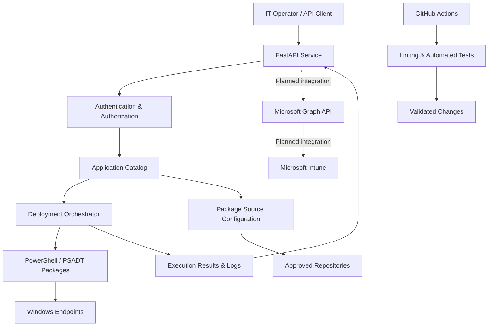

# Enterprise Deployment Automation Framework

**A modular IT automation project for standardized Windows application deployment, endpoint remediation, and API-driven operations.**

[](https://learn.microsoft.com/en-us/powershell/)
[](https://www.python.org/)
[-009688?logo=fastapi&logoColor=white)](https://fastapi.tiangolo.com/)
[](https://www.microsoft.com/windows)
[](https://github.com/features/actions)

## Overview

Enterprise Deployment Automation Framework is a portfolio project exploring how software engineering principles can improve enterprise IT operations.

The project aims to centralize reusable application deployment packages, automate common endpoint maintenance tasks, and expose deployment catalog capabilities through a REST API.

It follows a modular architecture that separates application packaging, endpoint automation, API services, configuration, and continuous integration.

The framework is designed around realistic enterprise scenarios involving Windows endpoints and software management ecosystems such as Microsoft Intune and Microsoft Configuration Manager (SCCM).

The deployment engine is called **DeployForge**: a PowerShell module that reads the application catalog, builds deployment plans, and installs or uninstalls applications through WinGet.

**Project focus:** IT Automation, Systems Engineering, Platform Engineering, and DevOps.

> **Project status:** Development / Proof of Concept. Features and integrations are implemented incrementally. Microsoft Intune, Configuration Manager, and Microsoft Graph API connectivity must be considered planned until their respective integrations have been implemented and tested.

## Current Status

| Component | State |
|---|---|
| Application catalog (21 applications) | Implemented |
| Catalog JSON Schema (Draft 2020-12) | Implemented |
| Catalog validator (`tools/validate_catalog.py`) | Implemented and tested with pytest |
| DeployForge PowerShell module | Implemented and tested with Pester (WinGet calls mocked) |
| Install and uninstall through WinGet (`winget` and `msstore` sources) | Implemented, with detection before and after each action and a log per operation |
| `direct` and `local` sources | Planned (the engine reports them as unsupported) |
| PSAppDeployToolkit packages | Planned (`entry_point` values are metadata only) |
| Endpoint remediation scripts | Planned |
| FastAPI catalog API (read-only, v0.1.0) | Implemented and tested with pytest |
| Deployment interface + local PowerShell agent (dry run, detect, confirmed install/uninstall) | Implemented and tested with pytest and Pester; real installs not yet verified in a VM |
| Deployment requests through the API | Planned |
| Microsoft Graph / Intune / SCCM integration | Planned |

## Engineering Objectives

- Standardize application installation, upgrade, uninstallation, and detection workflows.
- Reduce repetitive manual intervention in endpoint maintenance.
- Build reusable PowerShell automation with structured logging and error handling.
- Design a configuration-driven application catalog that separates metadata from installation binaries.
- Develop a REST API for application catalog management and controlled automation requests.
- Explore secure integration with Microsoft Graph API using OAuth 2.0 client credentials.
- Introduce automated testing, static analysis, and CI workflows.
- Establish a foundation for future self-service IT operations.

## Architecture



The architecture separates the control plane from endpoint execution.

- **API layer:** Receives authorized requests and validates inputs.
- **Catalog layer:** Stores application metadata and source configuration.
- **Automation layer:** Coordinates deployment and remediation workflows.
- **Endpoint layer:** Executes approved PowerShell scripts and application packages.
- **Integration layer:** Provides a future extension point for Microsoft Graph and endpoint management platforms.
- **CI layer:** Validates code quality and tests before changes are merged.

The diagram describes the intended architecture; it does not imply that every component or integration is already operational. Today, the catalog, schema, validator, DeployForge engine, read-only catalog API, the local deployment interface and agent ([docs/deployment-agent.md](docs/deployment-agent.md)), and CI are implemented. User authentication, a multi-user deployment orchestrator, and the Graph integration are not.

## Technology Stack

| Technology | Purpose | State |
|---|---|---|
| PowerShell 7.2+ | Windows administration, deployment, and remediation | In use |
| Pester | PowerShell testing | In use |
| Python 3.12 | Catalog validation and the REST API | In use |
| jsonschema | Catalog validation against JSON Schema | In use |
| FastAPI + Uvicorn | Read-only REST API and its OpenAPI documentation | In use |
| Pydantic v2 | API response contracts | In use |
| pytest + httpx2 | Python and API testing (`TestClient`) | In use |
| JSON / JSON Schema | Application metadata and source configuration | In use |
| GitHub Actions | Continuous integration and automated validation | In use |
| WinGet | Package source for most applications | Referenced in the catalog |
| PSAppDeployToolkit (PSADT) | Standardized application deployment workflows | Planned |
| Microsoft Graph API / OAuth 2.0 | Integration with Microsoft cloud management services | Planned |
| PSScriptAnalyzer | PowerShell static analysis | In use |

## Core Components

### 1. Application Catalog and Packaging

The catalog in `packages/catalog.json` describes each supported application. It currently lists 21 applications across these categories:

- **Browsers:** Google Chrome, Mozilla Firefox.
- **Productivity:** Microsoft 365 Apps, Notion.
- **Communication:** WhatsApp, Slack, Zoom.
- **Design:** Affinity, Figma, Inkscape, GIMP.
- **Development:** Visual Studio Code, Postman, Git, GitHub Desktop, Node.js LTS, Python 3.12, PowerShell 7.
- **Media:** Spotify, OBS Studio.
- **Utilities:** 7-Zip.

The catalog stores metadata only. No installers are committed to the repository.

Reusable deployment packages are intended to provide a consistent structure for each application. Each package should define:

- Application metadata and supported versions.
- Installation and uninstallation procedures.
- Silent installation parameters.
- Prerequisite and installation checks.
- Detection rules and exit codes.
- Structured logs and failure handling.
- Upgrade and repair behavior where supported.

PSADT is used as an existing deployment framework rather than presented as a custom implementation. The `entry_point` paths in the catalog are metadata in this phase: the referenced PowerShell files do not exist yet.

### 2. Configuration-Driven Package Sources

The package source configuration separates application metadata from the binaries themselves.

Example entry:

```json
{
  "schema_version": "1.0",
  "applications": [
    {
      "id": "google-chrome",
      "name": "Google Chrome",
      "version": "latest",
      "source": {
        "type": "winget",
        "package_id": "Google.Chrome"
      },
      "deployment": {
        "type": "psadt",
        "entry_point": "packages/browsers/google-chrome/Deploy-Application.ps1"
      }
    }
  ]
}
```

The schema in `catalog/schema/catalog.schema.json` defines the allowed fields:

| Field | Rules |
|---|---|
| `id` | Lowercase letters, digits, and single hyphens (for example `visual-studio-code`). Must be unique. |
| `name`, `version` | Non-empty strings. `latest` and `stable` mean "no pinned version". |
| `source.type` | `winget`, `msstore`, `direct`, or `local`. |
| `source.package_id` | Non-empty string (WinGet ID or Microsoft Store product ID). |
| `deployment.type` | `powershell` or `psadt`. |
| `deployment.entry_point` | Non-empty relative path (metadata in this phase). |

Unknown fields are rejected. The validator additionally rejects duplicate application IDs. WhatsApp uses the `msstore` source because its publisher distributes it through the Microsoft Store rather than the `winget` repository.

**Design principles:**

- Avoid committing large installers to Git.
- Support approved local or remote package repositories.
- Validate package metadata before execution.
- Make package source selection explicit and auditable.
- Treat external downloads as untrusted until their provenance and integrity have been verified.

The schema validates the shape of the data. It does not guarantee that a package exists, that an installer is legitimate, or that a script is safe. Those checks belong to later stages.

### 3. DeployForge PowerShell Engine

The module in `src/powershell/DeployForge/` provides three public functions:

| Function | Purpose |
|---|---|
| `Get-DeployForgeApplication` | Reads the catalog and returns all applications, or one by `-Id`. |
| `Get-DeployForgeDeploymentPlan` | Builds the plan for an `-Action` (`Install` by default, or `Uninstall`): the exact silent `winget` command and checks, without executing anything. |
| `Invoke-DeployForgeDeployment` | **Really installs or uninstalls** the application with WinGet. Supports `-WhatIf` (dry run: nothing is executed and no log is written) and `-Confirm` (`ConfirmImpact` is `High`, so it asks before acting unless `-Confirm:$false` is passed). |

`Invoke-DeployForgeDeployment` follows a fixed flow: build the plan, detect the current state with `winget list`, run `winget install` or `winget uninstall` only if the state needs to change, then detect again to verify the result. It returns a `DeployForge.DeploymentResult` object whose `Status` is one of `Installed`, `AlreadyInstalled`, `Uninstalled`, `NotInstalled`, `Failed`, `DryRun`, or `Skipped`, and writes one log file per operation under `logs/` (ignored by Git). The log is created before anything is detected or executed: if it cannot be written, the operation ends as `Failed` and winget is not run. Each log also records whether the session was elevated.

Current limits:

- Only the `winget` and `msstore` sources are executed; `direct` and `local` are reported as unsupported and nothing runs.
- PSADT `entry_point` scripts are never executed: they are metadata in this phase.
- Upgrades are not implemented.
- WinGet must be available, so execution only works on Windows.

The engine re-validates the fields that become command arguments or file paths: `package_id` and `version` must match a safe character pattern, and `entry_point` must be a relative path that stays inside the repository.

`tools/Test-DeployForgeLifecycle.ps1` runs a real install → reinstall → uninstall → uninstall cycle and records the evidence. It refuses to run outside Windows Sandbox unless `-AllowRealInstall` is passed. `tools/sandbox/Start-DeployForgeSandbox.ps1` runs that cycle unattended inside Windows Sandbox. Neither runs in CI.

### 4. Endpoint Remediation

PowerShell utilities will target common Windows endpoint maintenance scenarios. This component is planned.

Potential use cases include:

- Diagnosing Configuration Manager client cache issues.
- Checking the health and status of endpoint management services.
- Detecting problems with the Intune Management Extension.
- Collecting diagnostic information.
- Restarting services when appropriate.
- Producing structured execution results for troubleshooting.

Remediation scripts should separate detection from corrective actions wherever possible.

Destructive operations must be guarded by precondition checks, logging, and explicit error handling. Cache cleanup should use supported management mechanisms where available instead of indiscriminately deleting cache contents.

These scripts are intended for controlled testing in disposable virtual machines or other authorized lab environments, not for unvalidated deployment to production endpoints.

### 5. REST API (read-only catalog, v0.1.0)

The FastAPI service in `backend/app/` exposes the application catalog over HTTP. The catalog endpoints are **read-only**. The API never runs WinGet or PowerShell: deployments are queued for the separate local agent described in [docs/deployment-agent.md](docs/deployment-agent.md). There is no user authentication in this phase, so it is meant for local or lab use on a single-user machine.

`packages/catalog.json` is the only data source. Every request reads it and validates it against `catalog/schema/catalog.schema.json` (plus the unique-ID rule), so edits to the catalog are served on the next request without restarting. The API and `tools/validate_catalog.py` share the same validation code (`backend/app/core/catalog_validation.py`).

| Method | Endpoint | Success | Errors |
|---|---|---|---|
| `GET` | `/health` | 200 | — |
| `GET` | `/api/v1/applications` | 200 | 500 |
| `GET` | `/api/v1/applications/{application_id}` | 200 | 404, 422, 500 |

**`GET /health`**

```json
{"status": "ok", "service": "DeployForge API", "version": "0.1.0"}
```

**`GET /api/v1/applications`** returns every catalog application, in catalog order, and their count (`total` always equals the number of items):

```json
{
  "applications": [
    {
      "id": "google-chrome",
      "name": "Google Chrome",
      "version": "latest",
      "source": {"type": "winget", "package_id": "Google.Chrome"},
      "deployment": {"type": "psadt", "entry_point": "packages/browsers/google-chrome/Deploy-Application.ps1"}
    }
  ],
  "total": 21
}
```

**`GET /api/v1/applications/{application_id}`** returns one application with the same structure as an item above. Records are returned exactly as stored in the catalog; responses never contain fields outside this contract.

`application_id` is the catalog `id`, not `source.package_id`, and must match the catalog ID rule:

```text
^[a-z0-9]+(?:-[a-z0-9]+)*$     lowercase letters and digits, groups joined by single hyphens
```

| Request | Status |
|---|---|
| `/api/v1/applications/google-chrome` | 200 |
| `/api/v1/applications/application-inexistente` (well-formed, not in the catalog) | 404 |
| `/api/v1/applications/Google.Chrome`, `GOOGLE-CHROME`, `google_chrome`, `-x`, `google-` | 422 |

Every error uses the same body shape, `{"detail": "<message>"}`:

| Status | When | Body |
|---|---|---|
| 404 | Well-formed ID that is not in the catalog | `{"detail": "Application 'application-inexistente' not found."}` |
| 422 | Malformed `application_id` | `{"detail": "Invalid request parameter: application_id."}` |
| 500 | Catalog or schema missing or unreadable, malformed JSON, invalid schema, catalog that breaks the schema, or duplicate IDs | `{"detail": "The application catalog is unavailable."}` |
| 500 | The server produced a response outside its own contract, or hit an unexpected internal error | `{"detail": "Internal server error."}` |

Error responses never include stack traces, file paths, parser or schema messages, or the submitted value of a malformed parameter. The technical cause of a 500 is written to the server log instead.

**Interactive documentation** (generated by FastAPI while the API is running):

| URL | Content |
|---|---|
| `http://127.0.0.1:8000/docs` | Swagger UI |
| `http://127.0.0.1:8000/redoc` | ReDoc |
| `http://127.0.0.1:8000/openapi.json` | OpenAPI 3.1 document |

Swagger UI and ReDoc load their JavaScript and CSS from a public CDN, so the browser needs internet access to render them; `/openapi.json` does not.

**Not in this version:** write endpoints, deployment requests, execution of installations, authentication and authorization, pagination, and filtering. A future deployment request should never execute an arbitrary script or shell command: it should accept only validated identifiers and approved parameters, enforce authorization, and run work through a controlled background worker with a persistent job-status store.

### 6. Microsoft Graph Integration

The planned Graph integration provides an extension point for interacting with supported Microsoft cloud management resources.

The implementation will explore:

- OAuth 2.0 client credentials.
- Microsoft Entra application registration.
- Least-privilege application permissions.
- Token acquisition and expiration handling.
- Graph API error handling and throttling.
- Audit logs for management operations.

Credentials must be supplied through environment variables or a secrets manager and must never be committed to source control.

Actual API capabilities depend on the relevant Microsoft Graph endpoints, permissions, licensing, and management platform constraints.

### 7. CI and Code Quality

Three GitHub Actions workflows:

| Workflow | Runner | Trigger | Checks |
|---|---|---|---|
| `python-ci.yml` | `ubuntu-latest` | Pushes to `main` and `docs/**`, pull requests to `main` | Python 3.12, install `backend/requirements.txt`, catalog validation, then the full pytest suite (`tests/python` and `backend/tests`, deprecation warnings treated as errors) |
| `powershell-ci.yml` | `windows-latest` | Pushes to `main` and `docs/**`, pull requests to `main` | PSScriptAnalyzer, then Pester tests for the DeployForge module |
| `security.yml` | `ubuntu-latest` | Pushes to `main`, pull requests, weekly schedule | Secret scanning (gitleaks) and Python dependency audit (pip-audit on `backend/requirements.txt`) |

Planned checks:

- Python linting and static type checking.

CI validates code and configuration; it does not prove that a package installs successfully on every supported endpoint. Integration testing in a Windows lab remains necessary.

## Repository Structure

```text
deployment-automation-framework/
├── .github/
│   └── workflows/
│       ├── powershell-ci.yml
│       ├── python-ci.yml
│       └── security.yml
├── backend/
│   ├── app/                      # FastAPI application
│   │   ├── api/routes/           # HTTP endpoints (health, applications)
│   │   ├── core/                 # Settings, errors, shared catalog validation
│   │   ├── schemas/              # Pydantic response contracts
│   │   ├── services/             # Catalog loading and querying
│   │   └── main.py               # Application entry point
│   ├── tests/                    # API, service and schema tests
│   └── requirements.txt          # Python dependencies
├── catalog/
│   └── schema/
│       └── catalog.schema.json   # JSON Schema for the catalog
├── docs/
│   ├── evidence/                 # Validation evidence (day-4-validation.md)
│   ├── architecture.md
│   ├── security.md
│   ├── api-reference.md
│   └── troubleshooting.md
├── packages/
│   └── catalog.json              # Application metadata (21 applications)
├── src/
│   └── powershell/
│       └── DeployForge/          # PowerShell module (WinGet install/uninstall engine)
│           ├── Private/
│           ├── Public/
│           ├── DeployForge.psd1
│           └── DeployForge.psm1
├── tests/
│   ├── python/
│   │   └── test_catalog.py
│   └── powershell/
│       └── DeployForge.Tests.ps1
├── tools/
│   ├── sandbox/                  # Runs the lifecycle test inside Windows Sandbox
│   ├── Test-DeployForgeLifecycle.ps1  # Real install/uninstall lifecycle test (manual)
│   └── validate_catalog.py       # Catalog validator (CLI)
├── .gitignore
├── LICENSE
├── pytest.ini                    # pytest paths for tests/python and backend/tests
└── README.md
```

Planned additions, as the corresponding components are implemented: PSADT package templates and per-application packages under `packages/`, and endpoint remediation scripts.

## Getting Started

### Prerequisites

| Part | Platforms | Requirements |
|---|---|---|
| Catalog, validator, REST API, Python tests (steps 1–4) | Windows, macOS, or Linux | Git and Python 3.12 |
| DeployForge engine and Pester tests (steps 5–6) | Windows 10/11 | PowerShell 7.2+, Pester 5+, and WinGet for real installs |

Real installations and uninstallations only run on Windows: on other systems the engine can read the catalog and build plans, but refuses to run WinGet. Optional, for future package testing: PSAppDeployToolkit and a disposable Windows virtual machine or Windows Sandbox.

### 1. Clone the repository and install the Python dependencies

Windows (PowerShell):

```powershell
git clone https://github.com/gesualdiafonso/deployment-automation-framework.git
cd deployment-automation-framework

py -3.12 -m venv .venv
.\.venv\Scripts\Activate.ps1
python -m pip install -r backend/requirements.txt
```

If script execution is blocked, run the commands below with `.\.venv\Scripts\python.exe` instead of activating the environment.

macOS or Linux:

```bash
git clone https://github.com/gesualdiafonso/deployment-automation-framework.git
cd deployment-automation-framework

python3.12 -m venv .venv
source .venv/bin/activate
python -m pip install -r backend/requirements.txt
```

With the environment activated, the commands in steps 2–4 are the same on every system. All commands are run from the repository root.

### 2. Validate the catalog

```powershell
python tools/validate_catalog.py
```

Expected output:

```text
Catalog validation passed: 21 application(s).
```

The validator exits with code `0` on success, `1` when the catalog is invalid, and `2` when a file is missing, the JSON is malformed, or the schema itself is invalid.

### 3. Run the API

```powershell
python -m uvicorn app.main:app --app-dir backend --reload
```

The API listens on `http://127.0.0.1:8000` (`--reload` restarts it when the code changes; omit it outside development). Try it:

```powershell
Invoke-RestMethod http://127.0.0.1:8000/health
Invoke-RestMethod http://127.0.0.1:8000/api/v1/applications
Invoke-RestMethod http://127.0.0.1:8000/api/v1/applications/google-chrome
```

On macOS or Linux, use `curl`:

```bash
curl http://127.0.0.1:8000/health
curl http://127.0.0.1:8000/api/v1/applications/google-chrome
```

Or open `http://127.0.0.1:8000/docs` in a browser. See [REST API](#5-rest-api-read-only-catalog-v010) for every endpoint and status code. Stop the server with `Ctrl+C`.

### 4. Run the Python tests

```powershell
python -m pytest tests/python backend/tests -v -W error::DeprecationWarning
```

This is the same command the CI runs. It covers the catalog validator (`tests/python`) and the API, service and response schemas (`backend/tests`). No test installs software or needs network access.

### 5. Try the PowerShell engine

These commands only read the catalog and show what would run. Nothing is installed:

```powershell
Import-Module .\src\powershell\DeployForge\DeployForge.psd1 -Force
Get-DeployForgeApplication
Get-DeployForgeDeploymentPlan -Id google-chrome
Invoke-DeployForgeDeployment -Id whatsapp -WhatIf
```

Without `-WhatIf`, `Invoke-DeployForgeDeployment` installs or uninstalls the application for real. Run it only in a disposable VM or Windows Sandbox:

```powershell
Invoke-DeployForgeDeployment -Id 7zip                     # asks for confirmation, then installs
Invoke-DeployForgeDeployment -Id 7zip -Action Uninstall   # asks for confirmation, then uninstalls
```

### 6. Run the PowerShell tests

```powershell
Import-Module Pester -MinimumVersion 5.0
Invoke-Pester -Path tests/powershell -Output Detailed
```

### 7. Test endpoint scripts safely

Use a Windows virtual machine with a snapshot and no production management dependencies.

Before running a remediation script:

1. Read the script and verify its target paths and service names.
2. Confirm that its preconditions match the lab environment.
3. Run static analysis and tests.
4. Execute it with the minimum required privileges.
5. Review logs and verify the expected postconditions.

Do not use a blanket `Unrestricted` execution policy as a substitute for script validation or security controls.

## Security and Reliability

The framework follows several engineering principles:

- **Least privilege:** Restrict API access and use only the permissions required for each operation.
- **Input validation:** Validate package IDs, parameters, paths, and source metadata.
- **Secrets management:** Never store client secrets, access tokens, or credentials in Git.
- **Safe execution:** Allowlist approved deployment actions rather than executing arbitrary user-provided commands.
- **Observability:** Capture timestamps, operation IDs, execution outcomes, and actionable error details.
- **Idempotency:** Avoid unnecessary changes when the target application or configuration is already in the desired state.
- **Failure isolation:** Separate API failures from endpoint execution failures.
- **Auditability:** Record who requested an operation, what was requested, and the resulting status.
- **Controlled recovery:** Use explicit preconditions and recovery procedures for potentially disruptive operations.

Production use would require additional security reviews, permission configuration, deployment testing, and operational safeguards.

## Testing Strategy

The project uses a layered testing strategy. Some layers are in place and others are planned.

| Layer | Validation | State |
|---|---|---|
| Unit tests (Python) | Catalog schema, required fields, duplicate IDs, catalog service, response schemas kept in sync with the JSON Schema | In place |
| Unit tests (PowerShell) | Plan building, source types, path and package ID safety, `-WhatIf` behavior, install/uninstall flow with detection, verification, failures and logging (WinGet mocked), every catalog application resolving to a supported plan | In place |
| CI validation | Automated checks on every proposed change | In place |
| Static analysis | PowerShell code quality with PSScriptAnalyzer (Python linting planned) | In place (PowerShell) |
| API tests | HTTP status codes (200/404/422/500), response contracts, no internal details in errors | In place |
| API authorization tests | Access control | Planned (no authentication yet) |
| Package tests | Real install, detection, and uninstall in Windows Sandbox (`tools/Test-DeployForgeLifecycle.ps1`, run manually); upgrade | Install/uninstall tooling in place (manual, not in CI); upgrade planned |
| Integration tests | API-to-orchestrator and Graph connectivity | Planned |
| Recovery tests | Remediation behavior and failure handling | Planned |

Success criteria should be measurable: for example, passing test suites, correct detection results, expected exit codes, and successful recovery from documented failure scenarios.

## Roadmap

- [x] Establish repository structure and development conventions.
- [x] Implement and test the application catalog schema.
- [x] Expand the catalog to 21 applications across browsers, productivity, communication, design, development, media, and utilities.
- [x] Build the DeployForge dry-run engine (plan building and `-WhatIf`) with Pester tests.
- [x] Add WinGet install and uninstall with detection, post-action verification, and per-operation logs.
- [x] Add PSScriptAnalyzer to the PowerShell CI workflow.
- [ ] Implement real installation through WinGet with idempotency checks, structured results, and per-run logs, tested in Windows Sandbox.
- [ ] Create a reusable PSAppDeployToolkit package template.
- [ ] Develop one fully tested Windows application package.
- [ ] Implement safe diagnostic and remediation scripts.
- [x] Build the initial read-only FastAPI catalog endpoints and request validation.
- [ ] Add structured logging and deployment status tracking.
- [ ] Add authentication, authorization, and audit logging.
- [ ] Implement and test Microsoft Graph integration.
- [ ] Add a controlled background execution worker.
- [ ] Validate deployment workflows in a Windows lab.
- [ ] Document measured results and known limitations.

## Skills Demonstrated

This project is designed to demonstrate practical engineering skills in:

- Windows systems administration and endpoint management.
- PowerShell automation and application packaging.
- Python tooling and REST API design.
- Integration architecture and API authentication.
- Configuration-driven systems.
- CI, automated testing, and code quality.
- Troubleshooting, observability, and operational reliability.
- Security-conscious automation design.

The project is particularly relevant to IT Automation Engineer, Systems Engineer, Endpoint Management Engineer, Platform Engineer, and DevOps-oriented roles.

## Documentation and References

- [PSAppDeployToolkit Documentation](https://psappdeploytoolkit.com/docs/introduction)
- [WinGet Documentation](https://learn.microsoft.com/en-us/windows/package-manager/winget/)
- [Microsoft Intune Remediations](https://learn.microsoft.com/en-us/intune/device-management/tools/deploy-remediations)
- [Microsoft Graph Documentation](https://learn.microsoft.com/en-us/graph/overview)
- [FastAPI Documentation](https://fastapi.tiangolo.com/)
- [Pester Documentation](https://pester.dev/)
- [JSON Schema Documentation](https://json-schema.org/)
- [GitHub Actions Documentation](https://docs.github.com/en/actions)

## Author

**Afonso Gesualdi**

Systems Engineering · IT Automation · Platform Engineering

*Engineering reliable, reusable, and secure automation for modern IT operations.*

---

**Disclaimer:** This is an independent portfolio project intended for educational and demonstration purposes. It is not an official Microsoft product and does not imply affiliation with or endorsement by Microsoft. Enterprise integrations and capabilities are subject to implementation and testing.