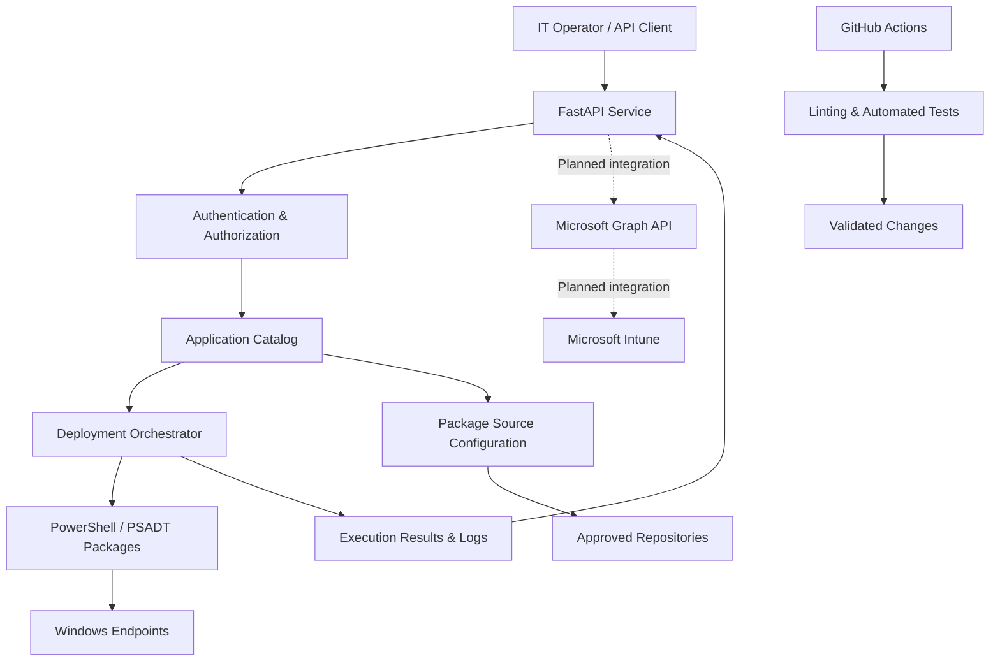

# Enterprise Deployment Automation Framework

**A modular IT automation project for standardized Windows application deployment, endpoint remediation, and API-driven operations.**

[](https://learn.microsoft.com/en-us/powershell/)
[](https://www.python.org/)
[-009688?logo=fastapi&logoColor=white)](https://fastapi.tiangolo.com/)
[](https://www.microsoft.com/windows)
[](https://github.com/features/actions)

## Overview

Enterprise Deployment Automation Framework is a portfolio project exploring how software engineering principles can improve enterprise IT operations.

The project aims to centralize reusable application deployment packages, automate common endpoint maintenance tasks, and expose deployment catalog capabilities through a REST API.

It follows a modular architecture that separates application packaging, endpoint automation, API services, configuration, and continuous integration.

The framework is designed around realistic enterprise scenarios involving Windows endpoints and software management ecosystems such as Microsoft Intune and Microsoft Configuration Manager (SCCM).

The deployment engine is called **DeployForge**: a PowerShell module that reads the application catalog and builds deployment plans.

**Project focus:** IT Automation, Systems Engineering, Platform Engineering, and DevOps.

> **Project status:** Development / Proof of Concept. Features and integrations are implemented incrementally. Microsoft Intune, Configuration Manager, and Microsoft Graph API connectivity must be considered planned until their respective integrations have been implemented and tested.

## Current Status

| Component | State |
|---|---|
| Application catalog (21 applications) | Implemented |
| Catalog JSON Schema (Draft 2020-12) | Implemented |
| Catalog validator (`tools/validate_catalog.py`) | Implemented and tested with pytest |
| DeployForge PowerShell module (dry-run engine) | Implemented and tested with Pester |
| Real installation through WinGet | Planned (the engine currently never installs anything) |
| PSAppDeployToolkit packages | Planned (`entry_point` values are metadata only) |
| Endpoint remediation scripts | Planned |
| FastAPI service | Planned |
| Microsoft Graph / Intune / SCCM integration | Planned |

## Engineering Objectives

- Standardize application installation, upgrade, uninstallation, and detection workflows.
- Reduce repetitive manual intervention in endpoint maintenance.
- Build reusable PowerShell automation with structured logging and error handling.
- Design a configuration-driven application catalog that separates metadata from installation binaries.
- Develop a REST API for application catalog management and controlled automation requests.
- Explore secure integration with Microsoft Graph API using OAuth 2.0 client credentials.
- Introduce automated testing, static analysis, and CI workflows.
- Establish a foundation for future self-service IT operations.

## Architecture



The architecture separates the control plane from endpoint execution.

- **API layer:** Receives authorized requests and validates inputs.
- **Catalog layer:** Stores application metadata and source configuration.
- **Automation layer:** Coordinates deployment and remediation workflows.
- **Endpoint layer:** Executes approved PowerShell scripts and application packages.
- **Integration layer:** Provides a future extension point for Microsoft Graph and endpoint management platforms.
- **CI layer:** Validates code quality and tests before changes are merged.

The diagram describes the intended architecture; it does not imply that every component or integration is already operational. Today, the catalog, schema, validator, DeployForge dry-run engine, and CI are implemented.

## Technology Stack

| Technology | Purpose | State |
|---|---|---|
| PowerShell 7.2+ | Windows administration, deployment, and remediation | In use |
| Pester | PowerShell testing | In use |
| Python 3.12 | Catalog validation, later API services and orchestration | In use |
| jsonschema | Catalog validation against JSON Schema | In use |
| pytest | Python testing | In use |
| JSON / JSON Schema | Application metadata and source configuration | In use |
| GitHub Actions | Continuous integration and automated validation | In use |
| WinGet | Package source for most applications | Referenced in the catalog |
| PSAppDeployToolkit (PSADT) | Standardized application deployment workflows | Planned |
| FastAPI | REST endpoints, request validation, and API documentation | Planned |
| Microsoft Graph API / OAuth 2.0 | Integration with Microsoft cloud management services | Planned |
| PSScriptAnalyzer | PowerShell static analysis | Planned |

## Core Components

### 1. Application Catalog and Packaging

The catalog in `packages/catalog.json` describes each supported application. It currently lists 21 applications across these categories:

- **Browsers:** Google Chrome, Mozilla Firefox.
- **Productivity:** Microsoft 365 Apps, Notion.
- **Communication:** WhatsApp, Slack, Zoom.
- **Design:** Affinity, Figma, Inkscape, GIMP.
- **Development:** Visual Studio Code, Postman, Git, GitHub Desktop, Node.js LTS, Python 3.12, PowerShell 7.
- **Media:** Spotify, OBS Studio.
- **Utilities:** 7-Zip.

The catalog stores metadata only. No installers are committed to the repository.

Reusable deployment packages are intended to provide a consistent structure for each application. Each package should define:

- Application metadata and supported versions.
- Installation and uninstallation procedures.
- Silent installation parameters.
- Prerequisite and installation checks.
- Detection rules and exit codes.
- Structured logs and failure handling.
- Upgrade and repair behavior where supported.

PSADT is used as an existing deployment framework rather than presented as a custom implementation. The `entry_point` paths in the catalog are metadata in this phase: the referenced PowerShell files do not exist yet.

### 2. Configuration-Driven Package Sources

The package source configuration separates application metadata from the binaries themselves.

Example entry:

```json
{
  "schema_version": "1.0",
  "applications": [
    {
      "id": "google-chrome",
      "name": "Google Chrome",
      "version": "latest",
      "source": {
        "type": "winget",
        "package_id": "Google.Chrome"
      },
      "deployment": {
        "type": "psadt",
        "entry_point": "packages/browsers/google-chrome/Deploy-Application.ps1"
      }
    }
  ]
}
```

The schema in `catalog/schema/catalog.schema.json` defines the allowed fields:

| Field | Rules |
|---|---|
| `id` | Lowercase letters, digits, and single hyphens (for example `visual-studio-code`). Must be unique. |
| `name`, `version` | Non-empty strings. `latest` and `stable` mean "no pinned version". |
| `source.type` | `winget`, `msstore`, `direct`, or `local`. |
| `source.package_id` | Non-empty string (WinGet ID or Microsoft Store product ID). |
| `deployment.type` | `powershell` or `psadt`. |
| `deployment.entry_point` | Non-empty relative path (metadata in this phase). |

Unknown fields are rejected. The validator additionally rejects duplicate application IDs. WhatsApp uses the `msstore` source because its publisher distributes it through the Microsoft Store rather than the `winget` repository.

**Design principles:**

- Avoid committing large installers to Git.
- Support approved local or remote package repositories.
- Validate package metadata before execution.
- Make package source selection explicit and auditable.
- Treat external downloads as untrusted until their provenance and integrity have been verified.

The schema validates the shape of the data. It does not guarantee that a package exists, that an installer is legitimate, or that a script is safe. Those checks belong to later stages.

### 3. DeployForge PowerShell Engine

The module in `src/powershell/DeployForge/` provides three public functions:

| Function | Purpose |
|---|---|
| `Get-DeployForgeApplication` | Reads the catalog and returns all applications, or one by `-Id`. |
| `Get-DeployForgeDeploymentPlan` | Builds the plan for an application (the exact `winget` command and checks) without executing anything. |
| `Invoke-DeployForgeDeployment` | Supports `-WhatIf` and `-Confirm`. In this version it never installs anything: with `-WhatIf` it shows the plan, without it it warns that execution is not implemented. |

The engine re-validates the fields that become command arguments or file paths: `package_id` and `version` must match a safe character pattern, and `entry_point` must be a relative path that stays inside the repository.

### 4. Endpoint Remediation

PowerShell utilities will target common Windows endpoint maintenance scenarios. This component is planned.

Potential use cases include:

- Diagnosing Configuration Manager client cache issues.
- Checking the health and status of endpoint management services.
- Detecting problems with the Intune Management Extension.
- Collecting diagnostic information.
- Restarting services when appropriate.
- Producing structured execution results for troubleshooting.

Remediation scripts should separate detection from corrective actions wherever possible.

Destructive operations must be guarded by precondition checks, logging, and explicit error handling. Cache cleanup should use supported management mechanisms where available instead of indiscriminately deleting cache contents.

These scripts are intended for controlled testing in disposable virtual machines or other authorized lab environments, not for unvalidated deployment to production endpoints.

### 5. REST API

The FastAPI service is intended to expose a controlled interface for catalog operations and automation requests. It is not implemented yet.

Proposed capabilities:

| Endpoint | Purpose |
|---|---|
| `GET /health` | Check API availability |
| `GET /api/v1/packages` | List available packages |
| `GET /api/v1/packages/{package_id}` | Retrieve package metadata |
| `POST /api/v1/deployments` | Submit a deployment request |
| `GET /api/v1/deployments/{deployment_id}` | Retrieve execution status |

These endpoints represent the proposed API contract and should be treated as planned until implemented.

A deployment request should not automatically execute an arbitrary script or shell command. The service should accept only validated package identifiers and approved parameters, enforce authorization, and execute work through a controlled orchestration mechanism.

Long-running deployment jobs should eventually use a background worker and a persistent job-status store rather than blocking an HTTP request.

### 6. Microsoft Graph Integration

The planned Graph integration provides an extension point for interacting with supported Microsoft cloud management resources.

The implementation will explore:

- OAuth 2.0 client credentials.
- Microsoft Entra application registration.
- Least-privilege application permissions.
- Token acquisition and expiration handling.
- Graph API error handling and throttling.
- Audit logs for management operations.

Credentials must be supplied through environment variables or a secrets manager and must never be committed to source control.

Actual API capabilities depend on the relevant Microsoft Graph endpoints, permissions, licensing, and management platform constraints.

### 7. CI and Code Quality

Two GitHub Actions workflows run on pushes to `main` and `docs/**` branches, and on pull requests to `main`:

| Workflow | Runner | Checks |
|---|---|---|
| `python-ci.yml` | `ubuntu-latest` | Catalog validation against the schema, then pytest |
| `powershell-ci.yml` | `windows-latest` | Pester tests for the DeployForge module |

Planned checks:

- PowerShell static analysis with PSScriptAnalyzer.
- API schema and request-validation tests.
- Dependency and secret scanning.

CI validates code and configuration; it does not prove that a package installs successfully on every supported endpoint. Integration testing in a Windows lab remains necessary.

## Repository Structure

```text
deployment-automation-framework/
├── .github/
│   └── workflows/
│       ├── powershell-ci.yml
│       └── python-ci.yml
├── backend/
│   └── requirements.txt          # Python dependencies (FastAPI planned)
├── catalog/
│   └── schema/
│       └── catalog.schema.json   # JSON Schema for the catalog
├── docs/
│   ├── architecture.md
│   ├── security.md
│   ├── api-reference.md
│   └── troubleshooting.md
├── packages/
│   └── catalog.json              # Application metadata (21 applications)
├── src/
│   └── powershell/
│       └── DeployForge/          # PowerShell module (dry-run engine)
│           ├── Private/
│           ├── Public/
│           ├── DeployForge.psd1
│           └── DeployForge.psm1
├── tests/
│   ├── python/
│   │   └── test_catalog.py
│   └── powershell/
│       └── DeployForge.Tests.ps1
├── tools/
│   └── validate_catalog.py       # Catalog validator
├── .gitignore
├── LICENSE
└── README.md
```

Planned additions, as the corresponding components are implemented: the FastAPI service, PSADT package templates and per-application packages under `packages/`, and endpoint remediation scripts.

## Getting Started

### Prerequisites

- Windows 10/11 and Git.
- Python 3.12.
- PowerShell 7.2+ and Pester 5+.
- Optional, for future package testing: PSAppDeployToolkit and a disposable Windows virtual machine or Windows Sandbox.

### 1. Clone the repository and validate the catalog

```powershell
git clone https://github.com/gesualdiafonso/deployment-automation-framework.git
cd deployment-automation-framework

py -3.12 -m venv .venv
.\.venv\Scripts\python.exe -m pip install -r backend/requirements.txt
.\.venv\Scripts\python.exe tools/validate_catalog.py
```

Expected output:

```text
Catalog validation passed: 21 application(s).
```

The validator exits with code `0` on success, `1` when the catalog is invalid, and `2` when a file is missing, the JSON is malformed, or the schema itself is invalid.

### 2. Run the Python tests

```powershell
.\.venv\Scripts\python.exe -m pytest tests/python -v
```

### 3. Try the PowerShell engine (dry run: nothing is installed)

```powershell
Import-Module .\src\powershell\DeployForge\DeployForge.psd1 -Force
Get-DeployForgeApplication
Get-DeployForgeDeploymentPlan -Id google-chrome
Invoke-DeployForgeDeployment -Id whatsapp -WhatIf
```

### 4. Run the PowerShell tests

```powershell
Import-Module Pester -MinimumVersion 5.0
Invoke-Pester -Path tests/powershell -Output Detailed
```

### 5. Test endpoint scripts safely

Use a Windows virtual machine with a snapshot and no production management dependencies.

Before running a remediation script:

1. Read the script and verify its target paths and service names.
2. Confirm that its preconditions match the lab environment.
3. Run static analysis and tests.
4. Execute it with the minimum required privileges.
5. Review logs and verify the expected postconditions.

Do not use a blanket `Unrestricted` execution policy as a substitute for script validation or security controls.

## Security and Reliability

The framework follows several engineering principles:

- **Least privilege:** Restrict API access and use only the permissions required for each operation.
- **Input validation:** Validate package IDs, parameters, paths, and source metadata.
- **Secrets management:** Never store client secrets, access tokens, or credentials in Git.
- **Safe execution:** Allowlist approved deployment actions rather than executing arbitrary user-provided commands.
- **Observability:** Capture timestamps, operation IDs, execution outcomes, and actionable error details.
- **Idempotency:** Avoid unnecessary changes when the target application or configuration is already in the desired state.
- **Failure isolation:** Separate API failures from endpoint execution failures.
- **Auditability:** Record who requested an operation, what was requested, and the resulting status.
- **Controlled recovery:** Use explicit preconditions and recovery procedures for potentially disruptive operations.

Production use would require additional security reviews, permission configuration, deployment testing, and operational safeguards.

## Testing Strategy

The project uses a layered testing strategy. Some layers are in place and others are planned.

| Layer | Validation | State |
|---|---|---|
| Unit tests (Python) | Catalog schema, required fields, duplicate IDs | In place |
| Unit tests (PowerShell) | Plan building, source types, path and package ID safety, `-WhatIf` behavior, every catalog application resolving to a supported plan | In place |
| CI validation | Automated checks on every proposed change | In place |
| Static analysis | PowerShell and Python code quality | Planned |
| API tests | HTTP status codes, schemas, and authorization | Planned |
| Package tests | Installation, detection, upgrade, and uninstall | Planned |
| Integration tests | API-to-orchestrator and Graph connectivity | Planned |
| Recovery tests | Remediation behavior and failure handling | Planned |

Success criteria should be measurable: for example, passing test suites, correct detection results, expected exit codes, and successful recovery from documented failure scenarios.

## Roadmap

- [x] Establish repository structure and development conventions.
- [x] Implement and test the application catalog schema.
- [x] Expand the catalog to 21 applications across browsers, productivity, communication, design, development, media, and utilities.
- [x] Build the DeployForge dry-run engine (plan building and `-WhatIf`) with Pester tests.
- [ ] Add PSScriptAnalyzer to the PowerShell CI workflow.
- [ ] Implement real installation through WinGet with idempotency checks, structured results, and per-run logs, tested in Windows Sandbox.
- [ ] Create a reusable PSAppDeployToolkit package template.
- [ ] Develop one fully tested Windows application package.
- [ ] Implement safe diagnostic and remediation scripts.
- [ ] Build the initial FastAPI endpoints and request validation.
- [ ] Add structured logging and deployment status tracking.
- [ ] Add authentication, authorization, and audit logging.
- [ ] Implement and test Microsoft Graph integration.
- [ ] Add a controlled background execution worker.
- [ ] Validate deployment workflows in a Windows lab.
- [ ] Document measured results and known limitations.

## Skills Demonstrated

This project is designed to demonstrate practical engineering skills in:

- Windows systems administration and endpoint management.
- PowerShell automation and application packaging.
- Python tooling and, later, REST API design.
- Integration architecture and API authentication.
- Configuration-driven systems.
- CI, automated testing, and code quality.
- Troubleshooting, observability, and operational reliability.
- Security-conscious automation design.

The project is particularly relevant to IT Automation Engineer, Systems Engineer, Endpoint Management Engineer, Platform Engineer, and DevOps-oriented roles.

## Documentation and References

- [PSAppDeployToolkit Documentation](https://psappdeploytoolkit.com/docs/introduction)
- [WinGet Documentation](https://learn.microsoft.com/en-us/windows/package-manager/winget/)
- [Microsoft Intune Remediations](https://learn.microsoft.com/en-us/intune/device-management/tools/deploy-remediations)
- [Microsoft Graph Documentation](https://learn.microsoft.com/en-us/graph/overview)
- [FastAPI Documentation](https://fastapi.tiangolo.com/)
- [Pester Documentation](https://pester.dev/)
- [JSON Schema Documentation](https://json-schema.org/)
- [GitHub Actions Documentation](https://docs.github.com/en/actions)

## Author

**Afonso Gesualdi**

Systems Engineering · IT Automation · Platform Engineering

*Engineering reliable, reusable, and secure automation for modern IT operations.*

---

**Disclaimer:** This is an independent portfolio project intended for educational and demonstration purposes. It is not an official Microsoft product and does not imply affiliation with or endorsement by Microsoft. Enterprise integrations and capabilities are subject to implementation and testing.